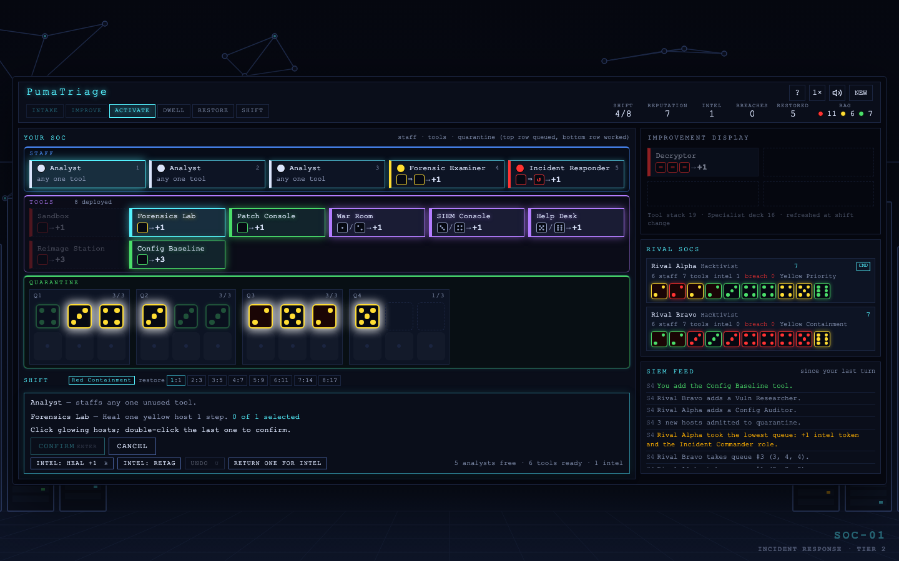
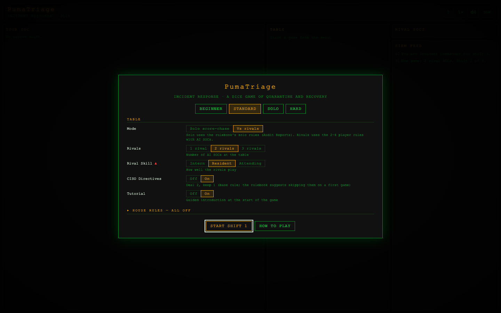

# PumaTriage

**An incident-response dice game.** Run a Security Operations Center, work compromised hosts back to health, and restore them to production before dwell time finishes them off, against one to three AI rivals or alone in a solo score-chase.

**Play:** [greykit.com/games/pumatriage](https://greykit.com/games/pumatriage/)

## How it plays

Compromised hosts are dice, and the face is the host's integrity: 1 is about to be lost, 6 is nearly clean. Each shift you take a queue of hosts, add one new tool or specialist, then place your staff on tools to raise integrity. A host healed past 6 is restored and scores reputation; one that drops below 1 is a breach. Hosts left waiting in a queued slot lose integrity to dwell time. Eight shifts; most reputation wins.

Presets run from one easy rival to three experts with extra trouble, and Custom mixes rivals, skill, expansions and house rules. Solo play adds Audit Reports and grades the result S to F. A tutorial runs on the first game, and **How to Play** in the game explains every card and symbol.

## Keys

Best on a desktop or laptop screen. Click a staff member, then a tool, then the hosts it should work on.

A touchscreen works too: tap where you would click, and press and hold a card or button to read what it does without acting.

| Key | Action |
|---|---|
| 1–9 | Select an analyst or specialist |
| Enter | Confirm the highlighted action |
| U | Undo the last placement |
| E | End activation |
| H or ? | How to Play |
| M | Sound on/off |

## Saves

Kept in the browser's `localStorage` under keys starting `pumatriage_`. **Settings → Forget everything** clears them.

## Credits

By Matthew "Shan" Romanek, with Claude. Built by [greykit.com](https://greykit.com/).

Made for my own play. Nothing here is offered: no support, no updates, no licence.
