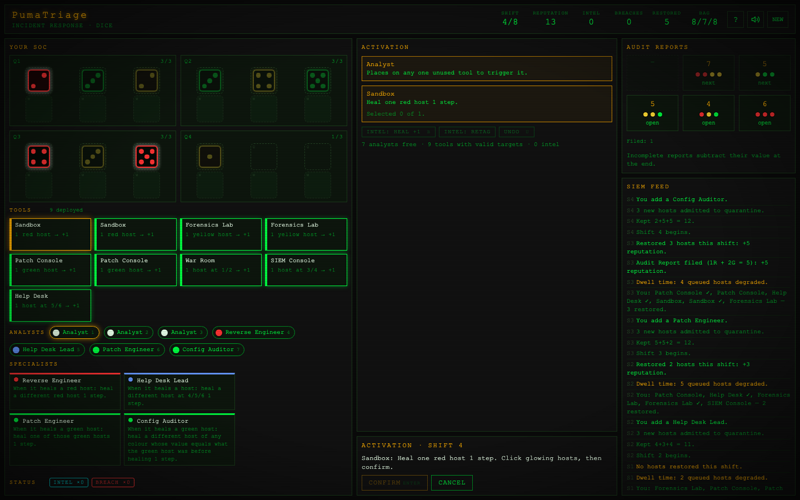
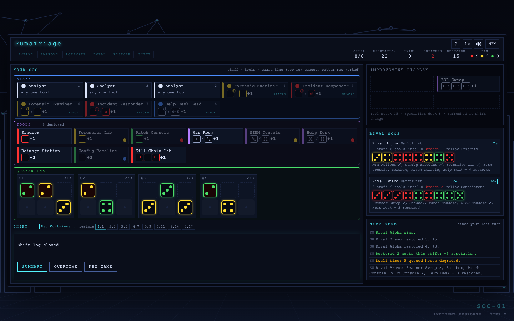

# PumaTriage

**An incident-response dice game.** Run a Security Operations Center, work compromised hosts back to health, and restore them to production before dwell time finishes them off.

Play against one to three AI rivals, or alone in a solo score-chase.

## Play

**[greykit.com/games/pumatriage](https://greykit.com/games/pumatriage/)**

Nothing to install. It runs in any modern browser and plays best on a desktop or laptop screen. Your game saves as you go, so you can close the tab and pick up the same shift later.

## The basics

Compromised hosts are dice. The face is the host's **integrity**: 1 is about to be lost, 6 is nearly clean. Each shift you put your analysts and specialists on your tools to raise integrity.

- A host healed past 6 is **restored** to production and scores reputation.
- A host that drops below 1 is a **breach** and costs 2 reputation at the end.
- Dice colours are just colours: some tools and specialists only work on red, yellow or green hosts.

Your SOC has four **quarantine segments** of three slots each. A new host waits in the upper **Queued** slot; the first time it is worked on it drops to the **Worked** slot below. Only queued hosts suffer from dwell time.

Eight shifts. Most reputation wins.

## A shift

1. **Intake.** Three hosts are rolled into each escalation queue, and each SOC takes one queue. Taking the lowest queue earns an intel token and makes you **Incident Commander**, who picks first next shift but may not take queue #1.
2. **Improvement.** Take one new tool or one specialist from the display.
3. **Activation.** Place your staff on tools one at a time. Each tool and each staff member acts once per shift, and a tool can only be used if its whole effect can be carried out. A specialist adds a follow-up after the tool it staffs.
4. **Dwell time.** Every host still queued loses 1 integrity.
5. **Restoration.** This shift's restored hosts score together: 1st = 1, 2nd–6th = 2 each, 7th–8th = 3 each, 9th–10th = 4 each, 11th–12th = 5 each. Clearing all four segments scores 5 more.
6. **Shift change.** Staff come back, worked hosts move up to queued, the display refills.

**Intel tokens** can be spent during activation to heal any host 1 step or to change a host's colour before a tool works on it. Each one left at the end is worth 1 reputation.

**CISO Directives** (on by default against rivals): each SOC is dealt two at the start and keeps one, a scoring bonus or a shield for the whole game.

## Reading the cards

Every tool and specialist shows its rule as a row of dice: the hosts it works on, then what it does to them. Hover any card for the rule in words. **How to Play → Reading Cards** in the game is the key to every symbol, and the **Tools** and **Specialists** tabs list every card.

## Ways to play

The title screen's **New quick game** starts a shift straight away with the rules as they stand:
the standard SOC game until you change them. **Custom game** picks one of these, or any mix. A shift
in progress saves as you play, and **Resume game** picks it up.

- **MSSP:** one easy rival, no directives. The gentle start.
- **SOC:** two rivals, directives on. The standard game.
- **CIRT:** three expert rivals, plus an inherited mess, a worm outbreak and persistent threats.
- **Custom:** any mix of rivals, skill, expansions and house rules.
- **Solo:** no rivals. Each intake you roll four hosts and keep three, and six **Audit Reports** sit on display asking for particular sets of restored hosts. File them for points; any left unfiled count against you. Solo games are graded S to F.
- **Overtime:** when the final scorecard comes up you can play on from the same board for another eight shifts.

A 7-step tutorial runs on your first game and can be switched off in Custom game.

## Expansions

Switch these on under *Expansions* in setup (rival games only). They can be combined.

- **Virtualization.** Pink hypervisors arrive with guest hosts in a guest segment of their own. A hypervisor only degrades when it shares a segment and never breaches; a hypervisor and its guests restore together. Adds a 4th analyst, new tools, specialists and directives.
- **Network.** Escalation queues are replaced by a network map. Each shift your responder sets out from your jump host and walks the map's links collecting 3 hosts. Hosts at 2 carry recon tokens with one-shot effects, and the SOC with the lowest intake total goes first.
- **Procurement.** Send a staff member to a vendor desk for an upgrade that fits a tool for good and adds an extra effect after the tool's own, two per tool.

## House rules

All off by default; open *House rules* in setup.

- **Promo Specialists:** Consultant and Intake Coordinator join the specialists.
- **Beta Tooling:** four experimental tools and six more specialists.
- **Incident Events:** an event card each shift from shift 2.
- **Inherited Mess:** start with five compromised hosts instead of three.
- **Worm Outbreak:** each intake, one extra host lands straight in your quarantine.
- **Persistent Threat:** dwell time costs 2 integrity instead of 1.
- **MSSP Handover:** after the last shift, hand leftover hosts that match outside providers' requests over for +1 each; every host left costs 1.
- **Double breach / report penalty:** harder solo scoring.

## Controls

Click a staff member, then a tool, then the hosts it should work on. Double-click the last host to confirm.

| Key | Action |
|---|---|
| 1–9 | Select an analyst or specialist |
| Enter | Confirm the highlighted action |
| Escape | Cancel the selection or close a dialog |
| U | Undo the last placement |
| E | End activation |
| B | Spend an intel token to heal |
| H or ? | How to Play |
| M | Sound on/off |
| S | Rival speed: normal, fast, instant |

Every host, tool and staff member can be reached with Tab, the game announces what happens to screen readers, and animation calms down if your system asks for reduced motion.

## More games

- [PumaPanic](https://greykit.com/games/pumapanic/): cyber tower-defense card game
- [PumaSOC](https://greykit.com/games/pumasoc/): SOC management simulator
- [PumaSecure](https://greykit.com/games/pumasecure/): infosec roguelike network defense

More at [greykit.com](https://greykit.com/).

## Credits

By [shandower](https://gitlab.com/shandower) with AI assistance from Claude.
